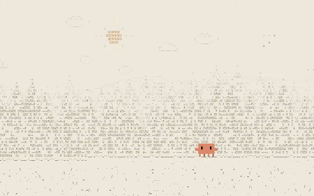

# Wanderer

An ambient ASCII world to study to. Clawd the crab travels through nine biomes (forest, rolling hills, town, lake, under the sea, a mountain dome, a snowy tundra, a desert, a canyon river) under a sky that follows your real clock, while the song playing in your Spotify app shows in a TV-style player. Study mode adds a timer while Clawd fishes for a journal of 19 fish.



## Requirements

- [Node.js](https://nodejs.org) 20.19+ or 22.12+
- macOS with the Spotify desktop app, for the music player (optional: the scenery runs without it)

## Run it

```bash
git clone https://github.com/eelizabethho/wanderer.git
cd wanderer
npm install
npm run dev
```

Open http://127.0.0.1:5173 and press `F` for full screen. Stop it with `Ctrl+C` in the terminal.

The first time it runs, macOS asks to let Terminal control Spotify; click **Allow**. Then play anything in Spotify and Wanderer follows along. To change songs, click the list icon (or press `O`) to bring Spotify to the front.

## Controls

| Key | Does |
|---|---|
| `M` | next biome (while studying, cycles the fishing spots) |
| `S` | start a study session |
| `P` | pause / resume the study timer |
| `J` | open the fish journal |
| `Esc` | close the journal or summary |
| `F` | full screen |
| `Space` | play / pause |
| `←` `→` | previous / next song |
| `O` | open the Spotify app to pick music |

## Options

Add these to the URL:

| URL | Does |
|---|---|
| `?switch=song` | change biome on every new song (default: every 6 minutes) |
| `?hour=22` | pin the time of day, e.g. to preview night |
| `?studyspeed=120` | run study time 120x faster, for demos (capped at 600) |

## Study mode

Clawd fishes in the lake and the canyon river while a count-up timer runs. He casts and catches on his own. The scene swaps between the two spots every 20 minutes.

- **Start**: press `S` or click **Study**.
- **Pause**: press `P` or click Pause. The line reels in and no fish bite.
- **Stop**: click Stop, then click **End session?** within 3 seconds. The second click keeps a long session from ending by accident. A summary of the session opens.
- **Bites**: one about every 8 to 10 minutes of study time. Paused time does not count.

Each fish has a tier. The odds slide in a straight line over the first 3 hours of a session, then hold. Any fish can show up at any time.

| Tier | Points | Odds at 0 min | Odds at 3 h+ |
|---|---|---|---|
| Common | 5 | 70% | 28% |
| Uncommon | 15 | 22% | 30% |
| Rare | 40 | 6% | 22% |
| Epic | 100 | 1.8% | 13% |
| Legendary | 300 | 0.2% | 7% |

The fish journal (`J`) lists this session's catches and every species you have found, with a fun fact for each. The summary shows what you caught and the points earned.

Progress saves in the browser (localStorage). A reload picks the session up where it was, and the journal keeps your catches across sessions. If the computer sleeps while the timer runs, the session auto-pauses at the moment it slept. If the browser blocks storage, study mode still works but nothing is saved.

## How it works

- **Scenes**: `public/design/` holds the scene engine from the Wanderer v2 design. On top of the design, the engine lights the terrain from the upper left (shadowed slopes and valleys get denser ink by day, moonlit slopes glow at night) and adds a moon halo and Clawd's ground shadow. `wanderer-biomes-more.js` adds the tundra, desert and canyon, `wanderer-fauna.js` adds animals to the original six biomes, and `clawd.js` swaps in Clawd and re-anchors the props.
- **Spotify**: `bridge/server.mjs` reads the desktop app through AppleScript, so it needs no login, works on Spotify Free, and only sees music playing on this Mac. Nothing is sent anywhere.
- **App**: `src/` runs the biome timer, keyboard controls and the player.
- **Study timer**: `src/study.ts` holds the session timer, bite schedule, sleep guard and saved journal (localStorage keys `wanderer.session.v1` and `wanderer.journal.v1`).
- **Study UI**: `src/study-ui.ts` draws the timer card, catch toasts, fish journal and session summary.
- **Fish**: `src/fish.ts` holds the 19 species and the tier points and odds.
- **Fishing scene**: `public/design/wanderer-fishing.js` draws Clawd's fishing sprite, line, bobber and catch animation.

Other commands: `npm test` runs the tests, `npm run build` makes a production build in `dist/`.

## Credits

Clawd's sprite is from [clawd-tank](https://github.com/marciogranzotto/clawd-tank) by Marcio Granzotto Rodrigues (MIT license).
